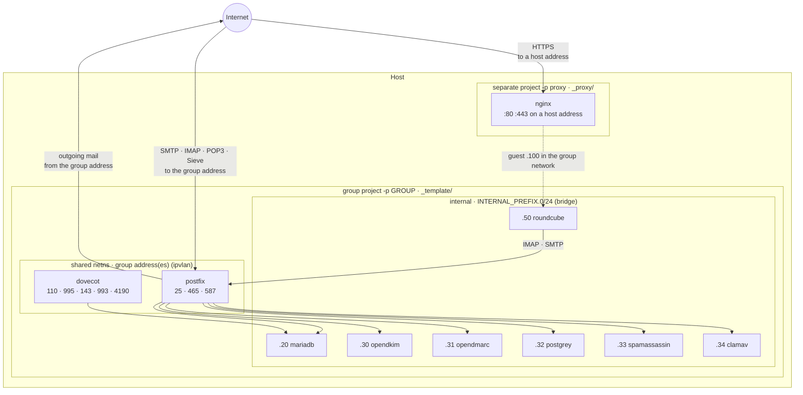

# Docker Mail Stack

A complete mail server — Postfix, Dovecot, MariaDB, Roundcube,
SpamAssassin, ClamAV, OpenDKIM, OpenDMARC, Postgrey — built on Docker
Compose so that **several independent groups of domains** can live on one
host, each on its own public IP and fully isolated from its neighbours.

The design goal is a stack that needs **exactly three manual operations**:

1. set up a group (describe it, bring it up),
2. add or remove a user,
3. change a user's password.

Everything else is the system's job: TLS certificates are issued and
renewed, DKIM keys are generated and the DNS records printed, spam is
filtered and learned from user actions, viruses are rejected during the
SMTP session, and policy tables live in SQL so no `postmap` is ever
needed. Every design decision in this repository is measured against that
goal; if a change would add a fourth manual operation, it is the wrong
change.

> **Status.** This is a periodic public export of a stack that carries
> production mail. Three existing non-containerized servers — a small
> domain group, an office with its own LAN, and an ISP-style relay with
> a few hundred subscribers — have been fully migrated onto it, plus a
> separate backup-MX group. The documentation here is written against
> hypothetical examples. See [About this repository](#about-this-repository).

## Contents

- [Who this is for](#who-this-is-for)
- [Features](#features)
- [Architecture](#architecture)
- [Quick start](#quick-start)
- [Day-to-day operations](#day-to-day-operations)
- [Group configuration reference](#group-configuration-reference)
- [Diagnostics](#diagnostics)
- [Repository layout](#repository-layout)
- [About this repository](#about-this-repository)

Further reading: [DECISIONS.md](DECISIONS.md) (why it is built this way —
code comments refer to these by number, e.g. «рішення №31»),
[PITFALLS.md](PITFALLS.md) (things that break silently),
[TODO.md](TODO.md), [CHANGELOG.md](CHANGELOG.md).

## Who this is for

The expected reader is comfortable with routing, L2/L3 and netfilter and
knows Linux and Docker in general terms. There is no "what is a container"
here; there is "why ipvlan L3 and not macvlan".

**Code comments are in Ukrainian.** The documentation is in English; the
comments in configs, entrypoints and `mailctl` are kept in the original
language because they are synced from the working repository on every
export. They often explain *why* a line exists and what broke before it
did, so they are worth running through a translator when you change
something non-obvious.

Comments refer to three archetypal groups, and the names are meaningful:

| name | profile |
|---|---|
| `small` | a handful of mailboxes, every client speaks TLS, no trusted networks |
| `office` | an office with its own LAN, a second private address in that LAN, trusts the LAN for relaying |
| `isp` | an ISP: wide `mynetworks` (subscribers send without auth), hundreds of mailboxes, legacy clients without TLS |
| `backup` | a group that only acts as a backup MX for others |

## Features

- **Per-group isolation.** Each group gets its own Postfix, Dovecot,
  MariaDB, Roundcube, SpamAssassin, ClamAV, OpenDKIM, OpenDMARC and
  Postgrey, stamped from a single parameterized Compose template. Only the
  images are shared.
- **Real public addresses on containers** via ipvlan L3 (or macvlan /
  ipvlan L2 for office LANs), described as data in `host.json`. A group may
  have several addresses (e.g. public + office LAN); outgoing mail always
  leaves from the group's primary address, so rDNS and SPF match.
- **SMTP**: 25 with postscreen (pregreet test, adaptive delays),
  `submission` on 587 (STARTTLS + SASL), `anvil` rate limits that also
  apply to trusted networks.
- **IMAP / POP3 / ManageSieve** on Dovecot 2.4, login by short login *or*
  full email address, `PLAIN`/`LOGIN` only under TLS (cleartext can be
  allowed per network or globally where legacy clients demand it).
- **Milters, not content filters**: OpenDKIM → OpenDMARC → ClamAV →
  SpamAssassin. Viruses are rejected *during* the SMTP session, so no
  backscatter is possible.
- **Spam learning from user actions**: moving a message into or out of
  `Junk` (any IMAP client, or the Roundcube button) trains the per-user
  Bayes database through `spamc`. Deleting spam does *not* train it as ham.
- **Roundcube** with password change, ManageSieve filters, mark-as-junk and
  per-user SpamAssassin preferences; it talks to the database through
  three least-privilege accounts (it can change a hash but cannot read it).
- **TLS** from Let's Encrypt via a one-shot certbot container, HTTP-01 or
  DNS-01 (Cloudflare, including CNAME delegation of `_acme-challenge` from
  a zone you don't control). Renewal reloads daemons only when the file
  actually changed.
- **Policy tables in SQL**: recipient-domain blocking with subdomains
  (index-friendly lookups even for 50k+ rows), time-limited abuse blocks by
  client IP or sender, aliases — all managed by `mailctl`, all effective
  immediately.
- **Backup MX for any group**: `domains.type='RELAY'`, delivery by DNS/MX,
  backscatter prevented with `reject_unverified_recipient` and a positive
  verification cache.
- **`mailctl`** — one Perl tool (core modules only, plus DBI for database
  commands) that validates every group before it starts, generates what
  Compose cannot express, and diagnoses what `docker ps` cannot see.

## Architecture



Arrows show who opens the connection.

- **Mail** arrives on the group's own address. Postfix is the only owner of
  the ipvlan attachment; Dovecot joins Postfix's network namespace
  (`network_mode: service:postfix`), so every mail service of a group
  listens on the same set of addresses — there is never a separate address
  per service. LMTP and SASL between them go over `127.0.0.1`.
- **Webmail** is served by one shared nginx outside the group stacks, on a
  host address. Roundcube has no public address at all; nginx joins the
  group's `internal` network as a guest and routes by `Host:`. The host
  cannot reach its own ipvlan slaves (a kernel restriction), which is why
  the webmail name must point to the *host*, not to the group:
  `mail.example.org` → group address, `webmail.example.org` → host address.
- **Inside a group** services reach each other by name over the `internal`
  bridge, with static addresses `${INTERNAL_PREFIX}.NN`.

```
${INTERNAL_PREFIX}.1     gateway (Docker)
${INTERNAL_PREFIX}.10    postfix  (and dovecot — shared netns)
${INTERNAL_PREFIX}.20    mariadb
${INTERNAL_PREFIX}.30    opendkim
${INTERNAL_PREFIX}.31    opendmarc
${INTERNAL_PREFIX}.32    postgrey
${INTERNAL_PREFIX}.33    spamassassin (milter; spamd also for learning)
${INTERNAL_PREFIX}.34    clamav (milter)
${INTERNAL_PREFIX}.50    roundcube
${INTERNAL_PREFIX}.100   nginx — guest from _proxy/
```

Why each piece is the way it is — ipvlan L3 rather than macvlan or NAT,
trixie rather than bookworm, milters rather than content filters, one
database per group, and so on — is in [DECISIONS.md](DECISIONS.md).

## Quick start

### Host requirements

- Docker Engine with Compose v2 or later (tested on Compose v5.x).
- `perl`. `mailctl` uses core modules only; the database commands
  (`user`, `domain`, `alias`, `policy`, `block`) additionally need DBI:
  `apt install libdbi-perl libdbd-mariadb-perl`.
- A block of public addresses **routed** to the host (typical on dedicated
  servers; in a lab, a static route to the block via the host).
- `net.ipv4.ip_forward=1` — in ipvlan L3 the host routes the public prefix
  into the containers.
- A free private /24 per group that is **not** used anywhere in your
  routed network (a container's connected route to its `internal` subnet
  shadows any external route to the same prefix).

Everything below goes through `./mailctl` in the repository root:

```bash
./mailctl help
```

### 0. Describe the host networks

An ipvlan/macvlan network can exist only **once per parent interface**, so
networks belong to the host and groups just take addresses in them.

```bash
cp host.json.example host.json
$EDITOR host.json
```

```json
{
  "networks": {
    "public": {
      "driver": "ipvlan", "mode": "l3", "iface": "eno1",
      "subnet": "203.0.113.80/28", "gateway": "203.0.113.81"
    },
    "office": {
      "driver": "macvlan", "iface": "eno1", "vlan": 8,
      "subnet": "192.168.50.0/24", "gateway": "192.168.50.1"
    }
  },
  "proxy": { "bind": "203.0.113.37" }
}
```

| Field | Meaning |
|---|---|
| key (`public`, `office`) | an **arbitrary label**; `ADDRESSES` in `group.env` refers to it, and the Docker network is named `mailstack-<label>` |
| `driver` | `ipvlan`, `macvlan` or `bridge` |
| `mode` | for ipvlan: `l3` (routed prefix) or `l2` (shared broadcast domain) |
| `iface` | host interface |
| `vlan` | optional tag; without it the network is native, with it the parent is `iface.vlan` (Docker creates the subinterface itself) |
| `subnet`, `gateway` | the **routed block**, not the link address. In L3 the gateway is not a next hop; it is reserved so no group gets it |
| `proxy.bind` | **required**: the host address the shared nginx binds 80/443 to (never `0.0.0.0` — other services on the host may own those ports) |

```bash
./mailctl net up         # create all networks (or name them)
./mailctl net status
```

`host.json` is in `.gitignore`: it describes one particular machine.

### 1. Build the shared images

Once per host, and again after package updates:

```bash
./mailctl build
```

### 2. Create a group

A group is a directory under `groups/` plus one env file:

```bash
cp -r groups/sample.domain.group groups/example.org
cp groups/example.org/group.env.example groups/example.org/group.env
$EDITOR groups/example.org/group.env
./mailctl check example.org
```

The minimum to fill in:

```ini
GROUP_CONFIG_DIR=../groups/example.org   # must match the directory name
GROUP_NAME=example                       # compose project name: [a-z0-9_-]
MAIL_HOSTNAME=mail.example.org
POSTMASTER_ADDRESS=postmaster@example.org
ADDRESSES=public:203.0.113.82
INTERNAL_PREFIX=10.11.11
DKIM_SELECTOR=ms2026
VMAIL_UID=8
VMAIL_GID=8
MYSQL_ROOT_PASSWORD=...
MYSQL_MAIL_PASSWORD=...
SA_DB_PASSWORD=...
WEBMAIL_FQDN=webmail.example.org
ROUNDCUBE_DB_PASSWORD=...
ROUNDCUBE_DES_KEY=...                     # exactly 24 characters
```

`mailctl check` validates the invariants before anything starts: the
labels in `ADDRESSES` exist in `host.json`, each address lies in its
network and is not the gateway, network or broadcast address, addresses
and `INTERNAL_PREFIX` are unique across groups, secrets are present and
contain only safe characters, and so on. The full list of variables is in
the [reference](#group-configuration-reference).

### 3. Put the database schema in place

```bash
./mailctl db-schema example.org
```

This copies the schema into `groups/example.org/mysql-init/` together with
the SpamAssassin state database (taken from the packaged SQL files *inside
the image*, so it always matches the installed version) and the Roundcube
database with its three accounts. `mysql-init` runs **only on the first
start** of MariaDB; for an already running group use
`./mailctl db-schema example.org --apply` or `./mailctl db-load`.

### 4. Bring the group up

```bash
./mailctl up example.org
./mailctl health example.org --wait
```

The template **cannot** be started with plain `docker compose`: the number
of external networks differs between groups and Compose has no loops, so
`mailctl` generates `groups/<g>/networks.yml` and `.compose.env` and merges
them in. `./mailctl generated example.org` shows what went into Compose.

`health` is the real check. `docker ps` only says a container runs; a
milter that does not listen lets mail through **unchecked and silently**
(`milter_default_action = accept`). `health` checks processes inside
multi-process containers and probes every milter and the database *from
the Postfix container*, because that is who connects to them.

### 5. Domains, mailboxes, DNS

```bash
./mailctl domain add  example.org example.org
./mailctl reload      example.org opendkim     # new domain → new DKIM key
./mailctl user add    example.org alice@example.org --random
./mailctl alias add   example.org postmaster@example.org alice@example.org
./mailctl dns         example.org              # A, PTR, MX, SPF, DKIM, DMARC
```

`dns` prints the complete record set ready for publishing, with notes on
what is deliberately conservative in it (`~all`, `p=none` as first steps).
`health` flags every local domain that has no `postmaster@`.

### 6. Certificates

Until a real certificate exists the group runs on a self-signed one that
the entrypoints generate in the same place. Then:

```bash
./mailctl certs example.org --dry-run
./mailctl certs example.org
```

- **HTTP-01** (default): the A record of `MAIL_HOSTNAME` must point to the
  group address and port 80 must reach the group.
- **DNS-01**: `ACME_METHOD=dns-cloudflare` in `group.env` and a token in
  `groups/<g>/acme.ini` (mode 600). The A record does not matter at all,
  which is handy while you are still migrating. If the zone is not on
  Cloudflare, delegate once with a static
  `_acme-challenge.mail.example.org. CNAME mail-example.acme.<your-zone>.`
- `--http-port=N` when port 80 reaches you via a proxy or DNAT.

Renewal is the same command **without a group name** — it walks every
running group, does nothing if more than 30 days remain, and reloads
daemons only when the certificate actually changed. Put it in a daily
systemd timer or cron:

```cron
17 4 * * *  cd /opt/Docker-Mail-Stack && ./mailctl certs >>/var/log/mailstack-certs.log 2>&1
```

Why a host timer and not a daemon inside the stack: Dovecot needs
`doveadm reload`, a container cannot reload its neighbour without the
Docker socket, and the Docker socket inside a container is root on the
host. Also, a failing timer is visible; a failing loop inside a container
is not.

### 7. Webmail

```bash
./mailctl proxy attach example.org
cp _proxy/nginx-config/conf.d/group.conf.example _proxy/nginx-config/conf.d/example.conf
$EDITOR _proxy/nginx-config/conf.d/example.conf   # {GROUP}, {INTERNAL_PREFIX}, {WEBMAIL_FQDN}
./mailctl proxy up
./mailctl certs --proxy example.org
```

`proxy up` puts a self-signed placeholder certificate where the real one
will go, so nginx can start before the real certificate is issued (the
HTTP-01 challenge arrives at the same nginx).

## Day-to-day operations

```bash
./mailctl user list    example.org
./mailctl user passwd  example.org alice@example.org          # prompts, or --random
./mailctl user disable example.org alice@example.org
./mailctl user del     example.org alice@example.org [--purge]
```

- There is **no `--password=`** and there will not be: arguments are
  visible in `ps` and end up in shell history. Use `--random` (shown once)
  or STDIN.
- **Dovecot does the hashing**, inside the group's container, with the
  scheme from its effective configuration (`ARGON2ID`). `mailctl` keeps no
  copy of that value. The price: a password cannot be set while the group
  is down.
- After editing a config, use **`reload`, not `up`**. Configs are
  bind-mounted and read at container start; for Compose nothing changed,
  so `up` recreates nothing. `reload` also *waits* until the recreated
  services listen again.

### Blocking

Two different tables. Do not mix them up:

```bash
# whom we do not deliver to: recipient domain, permanent, with subdomains
./mailctl policy add    example.org casino.example --comment='complaint 2026-11-17'
./mailctl policy import example.org --source=external-list list.txt
./mailctl policy test   example.org user@casino.example

# who cannot send through us: client IP or sender, always time-limited
./mailctl block add  example.org 198.51.100.7 --for=3d --reason='spam run'
./mailctl block add  example.org user@example.org --for=2h --reason='compromised'
./mailctl block test example.org 198.51.100.7
```

`policy import` synchronizes *within its own `--source`*: adds new,
removes vanished, never touches manual rows, and refuses an import that
would remove more than half of the source (a truncated download).

`block` has no "unblock" operation by design — a row simply stops matching
when it expires. Both block maps sit *above* `permit_mynetworks`;
otherwise they would never apply to the trusted networks they exist for.
`OK`/`PERMIT` actions are refused in both tables: a single such row turns a
block list into a whitelist that short-circuits every later check.

### Backup MX for someone else's domain

```bash
./mailctl domain add example.org partner.example --type=RELAY
./mailctl health     example.org
```

Then publish `MX 20 <MAIL_HOSTNAME of this group>` in the partner's zone
(worse priority than the primary). The name in the MX **must** equal this
group's `MAIL_HOSTNAME` — that is how Postfix recognises itself in the MX
list; otherwise mail loops. Recipients are verified against the primary
server and cached for 31 days, so during an outage of the primary, known
recipients are still accepted and unknown ones are deferred, never
bounced.

### Stopping

```bash
./mailctl down example.org             # volumes (mail, DB, queue) stay
./mailctl down example.org --volumes   # ALL mail and the database are gone
```

## Group configuration reference

Required variables are listed in [step 2](#2-create-a-group). Optional
ones, with their defaults:

| Variable | Default | Meaning |
|---|---|---|
| `PRIMARY_NET` | the only one | network whose address is used for outgoing mail and the default route |
| `MYNETWORKS` | empty | who may relay **without** authentication. Independent of `ADDRESSES` on purpose: having an address in a network is not trusting it |
| `CLEARTEXT_NETWORKS` | empty | where `PLAIN`/`LOGIN` is allowed without TLS: a list of networks, or the separate word `any`. `0.0.0.0/0` is refused (in `MYNETWORKS` it would be an open relay) |
| `AUTH_ALLOW_WEAK_SCHEMES` | `no` | needed for migrated `MD5-CRYPT`/`DES-CRYPT` hashes; Dovecot 2.4 refuses them by default and the failure looks like an internal error, not a wrong password |
| `ANVIL` / `ANVIL_EXCEPTIONS` | `yes` / `127.0.0.0/8` | per-client rate limits; exceptions deliberately do **not** default to `$mynetworks` |
| `GREYLIST`, `GREYLIST_DELAY`, `GREYLIST_MAX_AGE` | `yes`, `20`, `60` | Postgrey. With `GREYLIST=yes` and Postgrey down, *all* mail gets 451 — `health` says so |
| `POSTSCREEN_ACTION` | `enforce` | what postscreen does with a client that fails the tests |
| `SA_DNSBL` | `yes` | DNS blocklists in SpamAssassin; turn off if your resolver is a public one |
| `SPAM_TO_JUNK` | `no` | global sieve that files `X-Spam-Flag: YES` into Junk |
| `SIEVE_MAX_REDIRECTS` | `4` | `redirect` limit per script; exceeding it fails the whole script |
| `CERT_KEY_TYPE` | `ecdsa` | `rsa` if you still have clients that cannot do ECDSA |
| `ACME_METHOD`, `ACME_DNS_WAIT` | `http` | `dns-cloudflare` for DNS-01 |
| `SPF_EXTRA` | empty | additional SPF sources during a transition; must not contain its own `all` |
| `TZ` | `UTC` | container time zone (logs, `Received:`) |
| `DB_SCHEMA` | `mysql-mail` | schema variant from `_schemas/` |
| `WEBMAIL_MAX_UPLOAD` | `25M` | attachment size limit in Roundcube (nginx and PHP) |
| `IMAGE_TAG` | `trixie` | tag of the shared images |

Variables that look like they belong here but do **not**: `PUBLIC_IP`,
`PARENT_IFACE`, `PUBLIC_SUBNET`, `PUBLIC_GATEWAY`. They are derived from
`ADDRESSES` and `host.json`, and `mailctl check` refuses them — two values
that must agree eventually disagree silently.

Shared service configuration lives in `_configs/<service>/` and applies to
**all** groups after `mailctl reload`. A group overrides a file by placing
its own version with the same name in `groups/<g>/<service>-config/`. Do
not copy shared files into a group "just in case": the copy shadows the
shared file and later fixes stop reaching that group, silently.
`mailctl check` reports overrides.

## Diagnostics

```bash
./mailctl health  example.org [--wait]   # or: health --all
./mailctl config  example.org postfix    # effective config in a one-shot container
./mailctl netns   example.org            # addresses, routes, listeners in the group netns
./mailctl headers example.org alice@example.org <queue-id>
./mailctl logs    example.org postfix
./mailctl version
```

- **`config`** runs in a *one-shot* container with the same config and
  environment. That is the only way to see the error when the real
  container is in a restart loop and `docker exec` cannot get in.
- **`netns`** runs host binaries inside the group's network namespace —
  the images are slim and have neither `ip` nor `ss`.
- **`headers`** prints the whole header block and, given a queue ID, waits
  until the message is actually delivered. `250 Ok: queued` means
  accepted, not delivered; without waiting you look at the previous
  message.
- **The host cannot ping its own group addresses.** The root namespace
  cannot reach its own ipvlan/macvlan slaves; that is the kernel, not a
  misconfiguration. Test from outside, or add a shim interface for
  debugging.

More in [PITFALLS.md](PITFALLS.md).

## Repository layout

| Path | What it is |
|---|---|
| `mailctl` | the control tool |
| `host.json.example` | host networks (copy to `host.json`) |
| `_images/<service>/` | Dockerfiles and entrypoints, built on `debian:trixie-slim`; `build.sh` |
| `_template/docker-compose.yml` | the single group template |
| `_configs/<service>/` | shared service configuration for all groups |
| `_schemas/mysql-mail/` | the mail database schema; `_schemas/upgrade/` — DDL patches for running groups |
| `_proxy/` | the shared nginx, a separate Compose project |
| `groups/sample.domain.group/` | a group skeleton with `group.env.example` |

Only `groups/<g>/*`, `host.json` and `_proxy/nginx-config/conf.d/*.conf`
are edited per installation; they are all in `.gitignore` except the
samples.

### Upgrading a running installation

```bash
git pull
./mailctl build                 # images first: entrypoints change with configs
./mailctl reload <group>        # each group
./mailctl health --all
```

The order matters: a newer static config with an older image can leave a
setting with no source at all for a while. Schema changes for running
groups come as files in `_schemas/upgrade/` and are applied with
`./mailctl db-load <group> _schemas/upgrade/<file>.sql`; `health` tells you
when one is missing.

## About this repository

This is a **periodic export** of a private working repository. The code
(`mailctl`, images, configs, template, schema) is copied mechanically with
host names, addresses and a couple of site-specific features removed; the
documentation is written here separately. A `.public-sync/state` file
records the source revision of the last export.

What that means in practice:

- the git history here consists of export commits, not of the individual
  changes behind them;
- issues and pull requests are welcome, but a merged change is ported into
  the working repository by hand and comes back with the next export;
- examples use documentation ranges (RFC 5737) and reserved domains
  (RFC 2606) — `203.0.113.0/24`, `example.org` and the like.

License: GPL-2.0, see [LICENSE](LICENSE).
